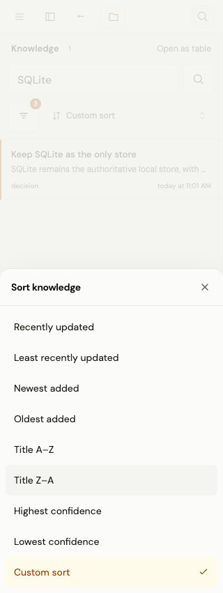
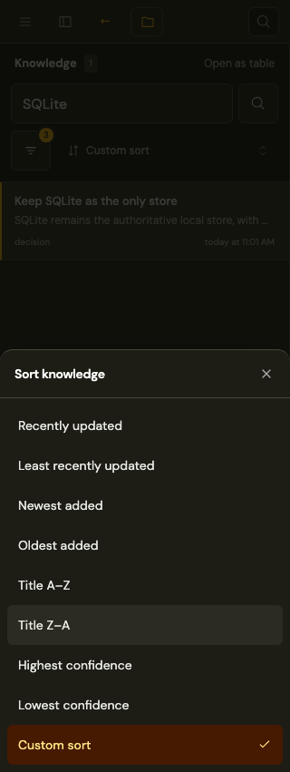
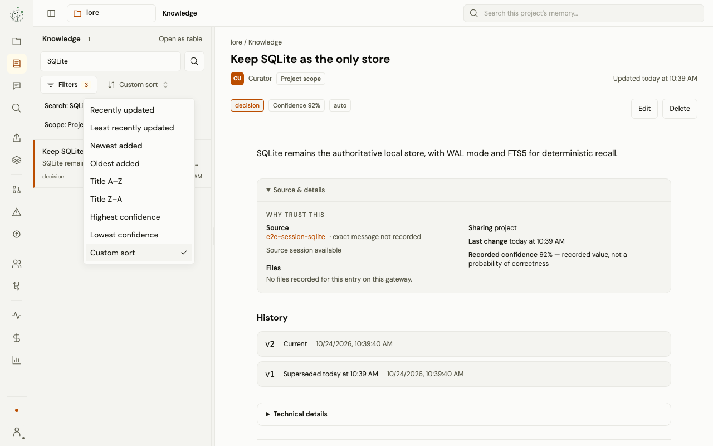
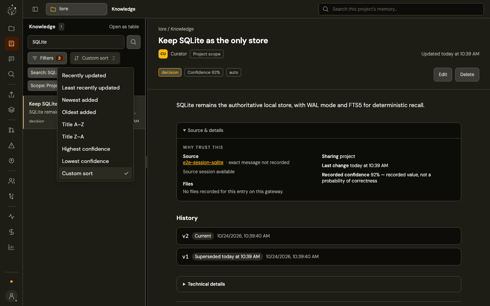

# UI workspace redesign

The current theme uses Tailwind amber accents and an olive foundation in both
light and dark mode. Owned Solid/shadcn components continue to consume semantic
roles, so pages do not name palette colors directly.

## Changing the palette

Edit the two scales at the top of `packages/ui/src/styles/app.css`:

- `--palette-base-50` through `--palette-base-950` reference Tailwind olive.
- `--palette-accent-50` through `--palette-accent-950` reference Tailwind amber.

Replace the family references throughout a scale to select another family.
The light/dark role mappings below those scales select the appropriate shades.
Buttons, links, focus rings, native controls, selections, passage highlights,
syntax accents, and avatars derive from those roles. Card, popover, sidebar,
input, secondary, border, text, and elevation roles derive from the base scale.

| Role | Light | Dark |
| --- | --- | --- |
| Outer background | Olive 100 | Olive 950 |
| Document/card surface | Olive 50 | Olive 900 |
| Raised/secondary surface | Olive 100 | Olive 800 |
| Default text | Olive 900 | Olive 200 |
| Secondary text | Olive 600 | Olive 400 |
| Actions, links, focus | Amber 700 | Amber 400 |
| Hovered accent | Amber 800 | Amber 300 |
| Selected background | Amber 50 | Amber 950 |
| Selected text | Amber 800 | Amber 200 |

The logo SVGs, categorical model chart palette, and green/red version diffs
remain unchanged. Cost bars, warming histograms, and quota bars use independent
`--chart-accent` / `--chart-emphasis` tokens with their previous green values.
Destructive states retain their red tokens.

## Layout and verification

Desktop retains the icon rail and collapsible context pane. Below 768px, a
logo-free toolbar button opens a labeled sliding drawer and the document uses
the full viewport width. The mobile account row is fully tappable, its panel
aligns with the drawer, and theme controls have 44px touch targets.

The knowledge reader keeps search above a compact Filters/sort row. A labeled
filter panel applies category and scope together, with explanations for project,
shared, and global visibility. Desktop shows applied filters as removable chips;
clearing them preserves the selected entry and sort order. On mobile, chips are hidden
and Clear all lives inside the filter sheet, leaving the toolbar compact. The
badge still reports applied filters. Both directions are available
for updated/created date, title, and confidence. Existing multi-column sorts from
the table remain intact. Desktop keeps its anchored popover. Below 768px, Filters
opens a full-width bottom sheet with a backdrop, a 44px close control, scrollable
fields, and a fixed action row with safe-area padding. Sheet motion follows the
reduced-motion preference. Nested selectors use modal accessibility scopes, and
closing/resizing restores focus to the current visible control. Short-screen
coverage includes 320×480 portrait and 568×320 landscape viewports.

On mobile, the reader's Filters trigger is a 44px icon button with an applied
filter count. Both layouts show a high-contrast amber number badge for applied
filters, including search, and announce the count to screen readers. Shared sheet
close icons are centered in 44px targets, inset 4px from the top-right corner.
Sorting opens a choice sheet, marks the current sort, and applies only after a
choice is activated; arrow navigation and dismissal preserve the
query. The same owned `ResponsiveSelect` is used for knowledge table category,
scope, and project filters, project search scope, entity type, and model usage
project selection. Desktop dropdowns keep their existing layout.
`BottomSheetContent` centralizes motion, safe areas, and scrolling, while the shared responsive overlay restores focus when a menu closes
or changes presentation across the breakpoint. The searchable project switcher
and controls already inside dialogs retain their specialized interactions.

Filter-count previews: [desktop](knowledge-toolbar-desktop-light.png) and
[mobile](knowledge-toolbar-mobile-light.png).

| Sort presentation | Light | Dark |
| --- | --- | --- |
| Mobile sheet |  |  |
| Desktop dropdown |  |  |

Screenshots use the disposable database seeded by the UI browser tests.
`responsive-layout.spec.ts` audits 23 routes at 1440, 390, and 320px in both
themes. `palette.spec.ts` verifies actual component colors, text contrast,
live palette propagation, and independent chart colors on desktop and mobile.
`folk03.spec.ts` covers populated team, promotion, and conflict layouts.
`folk-status.spec.ts` covers light/dark account and navigation panels.
`workspace-shell.spec.ts` and `model-usage.spec.ts` capture readers and charts.
Rebuild the gateway bundle before regenerating production-route screenshots.

The team captures show the pane scrolled to organization/invitation forms;
`team-invite-mobile-dark.png` is the invitation card detail. Gateway connection
captures are taken before entering the synthetic token used to check required
validation and Enter submission. The old overview capture documents an earlier
layout and is retained as historical reference.
