# Website UI and first-use journey

The website uses the local memory browser’s olive foundation, amber accents and
self-hosted fonts. Functional headings use DM Sans at medium/semibold weights,
with neutral titles, bounded panes, subtle borders, and compact selected navigation
states drawn from the local app. Serif lettering is reserved for the brand mark.
The first-use flow now leads with concrete product copy,
installation and a clearly fictional memory example. Shared navigation and compact
three-way icon theme pills give every section a consistent structure. Light,
System, and Dark have accessible names, native keyboard behavior, and persistent
selection; the System choice follows the device.

The homepage keeps the adventurer camp, one static app preview, a concise everyday
workflow, practical questions, and an installation link. The full app tour lives
at `/tour/`; the client-specific setup chooser lives in the installation guides.
Benchmark details and the team signup stay on their dedicated pages. Campfire, scribe’s desk, and quest gate still select
the native memory stages. The example now contrasts a durable webhook rule with an
unrelated lunch plan; the relevance story is explicitly illustrative.

The tour uses captures of the actual built Solid app with synthetic API fixtures.
It does not open a gateway or a production database. Native tour/setup choices work
without JavaScript; enhancement handles allowlisted setup/tour query state, browser
history, and clipboard feedback. The Knowledge preview opens that same tour view,
with an actual mobile app capture and a full-size link.
Docs guide a first recorded session, everyday use, troubleshooting, memory concepts,
data/costs, and a reproducible example. Pagefind search stays local to static public docs.
Task navigation precedes integrations and advanced references; generated references
retain their source-of-truth checks. Why Lore presents decision criteria, and blog
articles expose a practical takeaway, current availability, and a relevant next step.

See [the website package](../../packages/website/README.md) for maintenance and tests.

These are original Chromium screenshots of the built frontends. Before uses
upstream `82e1af50`; after uses this PR. Both builds use the same viewport, system colour preference,
and reduced-motion preference.
The GitHub release response is fixed to `0.34.0` for a stable badge. No DOM, CSS,
or image edits were applied to the captures. Desktop is 1280×900; mobile is
320×844.

| Surface | Before | After |
| --- | --- | --- |
| Homepage · desktop light | 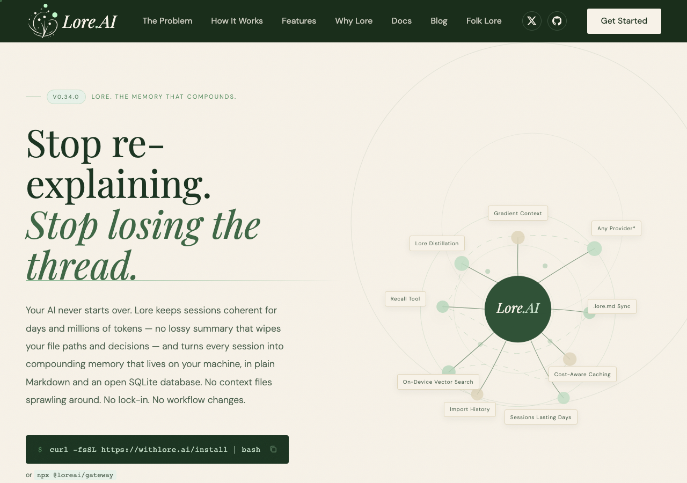 | 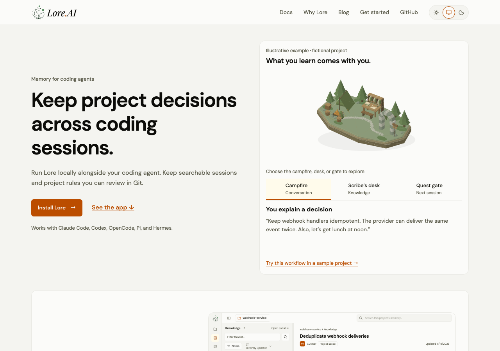 |
| Homepage · mobile dark | 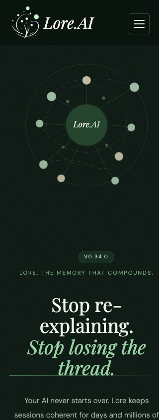 | 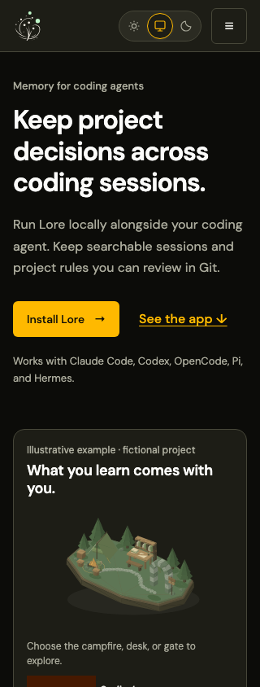 |
| Docs · desktop dark | 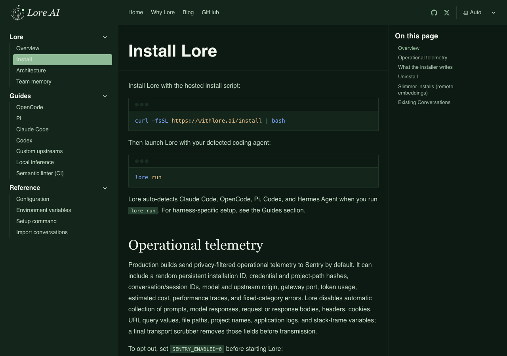 | 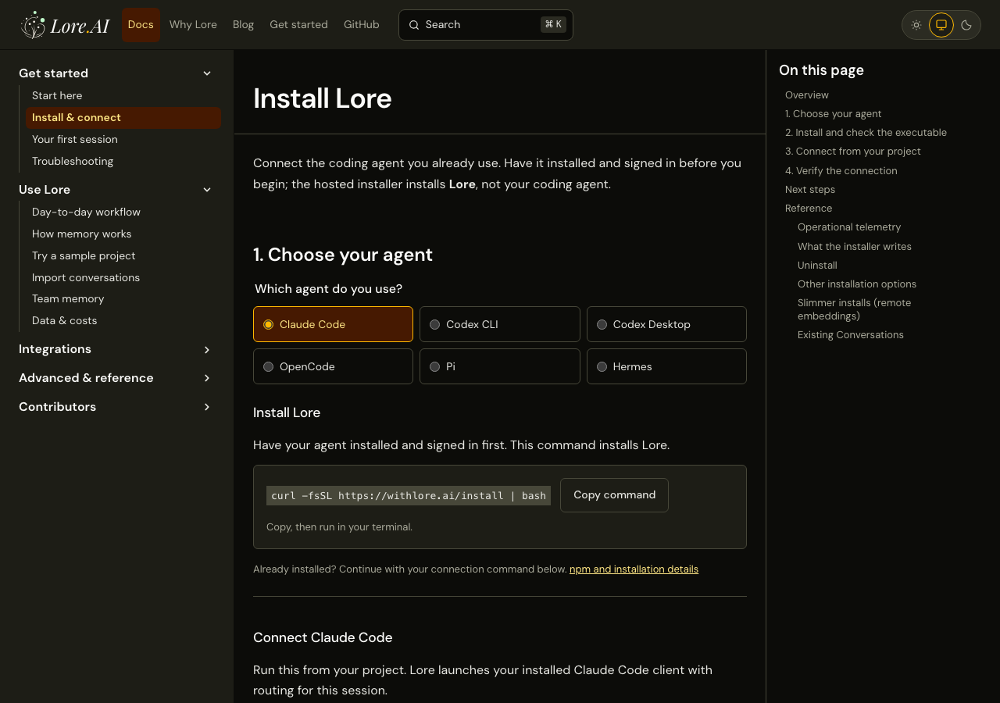 |
| Docs · mobile light | 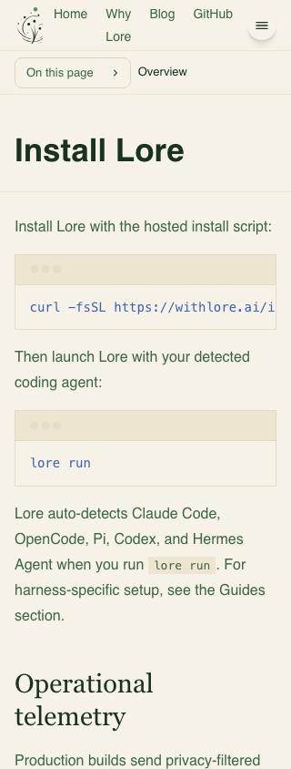 | 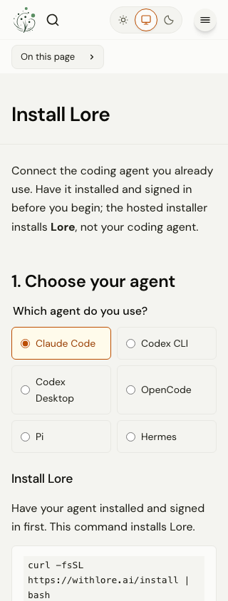 |
| Blog · desktop light | 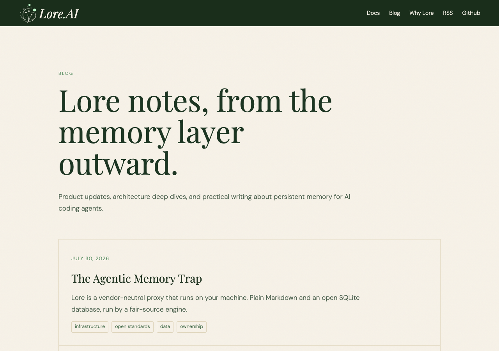 | 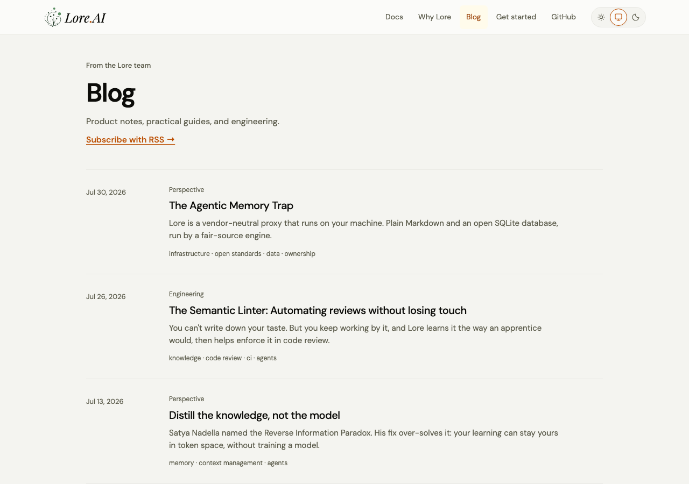 |

The additional camp captures below use normal motion at 1280×1000 with the
same fixed release response. The scene is settled; the dark image is a direct
component screenshot after selecting Knowledge. The comparison table above uses
reduced motion and shows the SVG fallback.

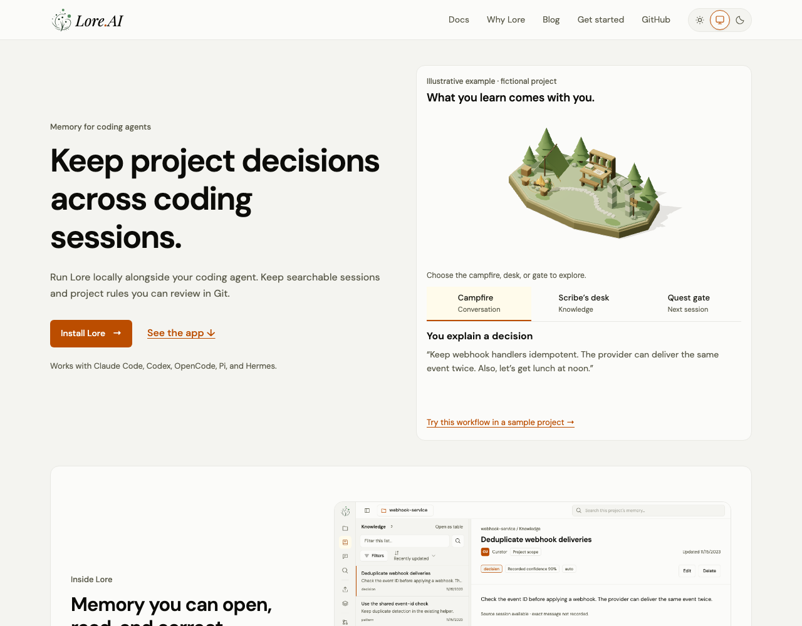
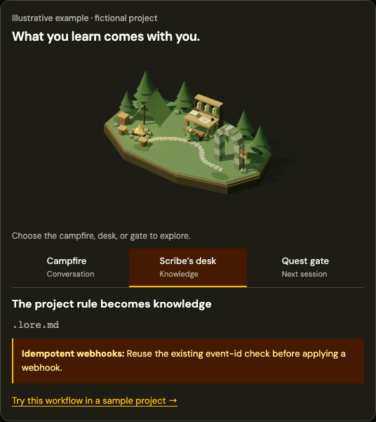

The interaction draws on [Emil Kowalski’s pointer and easing examples](https://emilkowal.ski/ui/good-vs-great-animations)
and [NN/G’s guidance on motion for comprehension](https://www.nngroup.com/articles/animation-usability/).
These informed direct selection, finite travel and immediate example text.
Landmark picking uses the existing Three.js package’s
[raycaster](https://threejs.org/manual/en/picking.html).

The simplified homepage product section links to the full tour instead of placing
its controls in the main page.

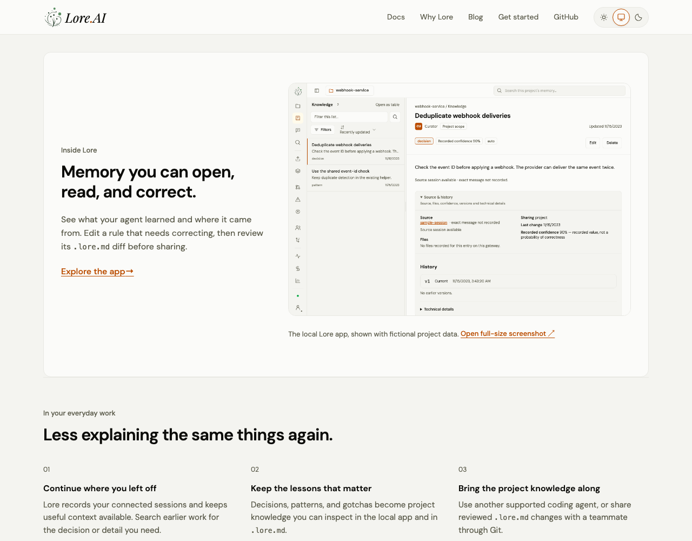

The theme selector replaces the former dropdown with direct icon choices.

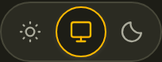

## Approved audit coverage

| Idea | Delivered behavior |
| --- | --- |
| 1. Actual product | One homepage Knowledge preview links to the full Sessions, Knowledge/source-history, and model-activity tour |
| 2. Agent selection | Installation and first-session guides offer six fixed choices, separate Codex CLI/Desktop paths, and Pi prerequisites |
| 3. First success | First-session guide checks a recorded message, with connection-to-verification links |
| 4. Everyday use | Task guide for resuming, finding decisions, correcting knowledge, switching agents, and sharing |
| 5. Camp relevance | The preserved camp follows the useful webhook rule and distinguishes unrelated conversation |
| 6. Memory concepts | Stored history, distillations, knowledge, and supplied context have distinct explanations |
| 7. Docs structure | Get started, Use Lore, Integrations, Advanced/reference, and Contributors groups |
| 8. Search | Built Pagefind with root and prefixed-preview search-result navigation verified |
| 9. Troubleshooting | Symptom-based checks and expected observations, plus safe issue-reporting guidance |
| 10. Reference clarity | Curated task intros, friendly environment groups, cleaned source-comment artifacts, generator parity |
| 11. Concrete benefits | One concise homepage workflow links to the daily-use guide for resuming, switching agents, and sharing |
| 12. Decision guide | Why Lore distinguishes instruction files, application memory infrastructure, agent frameworks, and existing-client memory |
| 13. Data and costs | Local/provider/embedding/telemetry boundaries, opt-out, import preview, and estimated-versus-billed usage |
| 14. Availability | Local/Git features and Folk Lore early access are explicit, including historical article notes |
| 15. Concise copy | Redundant copy instructions and fictional-example disclaimers removed; setup prerequisites clarified |
| 16. Hierarchy/navigation | Short homepage overview; full tour, setup, evaluation, and team signup disclosed on destination pages; functional docs headings |
| 17. Practical blog paths | Plain article kinds, takeaways, availability context, and specific next steps |
| 18. Reproducible proof | Webhook conversation, illustrative knowledge diff, later task, and separate observable milestones |

No new backend behavior, dependencies, accounts, permissions, or guaranteed performance
claims are introduced. The command contract test caught the incorrect `claude-code`
launch token before it was corrected to the actual `claude` executable.

## Follow-up design and accessibility audit

All eight approved improvements are included:

| Area | Delivered behavior |
| --- | --- |
| Navigation | Docs identifies its section; Get started remains an action rather than a second current destination |
| Setup state | Allowlisted agent selection persists in the URL, reload, Back, and Forward; delayed initialization preserves early native choices |
| Product preview | Knowledge preview opens the matching tour state; mobile uses actual 390×700 app captures; full-size originals remain linked |
| Selected state | Compact theme pill retains its size and now uses an accent border exceeding 3:1 against its surrounding fill |
| Hero explanation | One direct explanation of running Lore locally with an existing coding agent and reviewing project rules in Git |
| Proportions | Smaller camp artwork and tighter spacing preserve geometry, camera, native fallback, and stable stage-panel height |
| Articles | Long posts gain a native collapsible outline linked to generated heading IDs |
| Signup recovery | Email and form stay visible on failure, with associated feedback and a one-action retry |

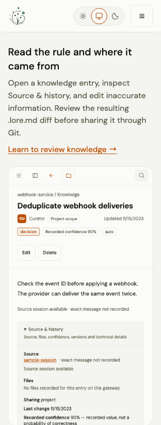
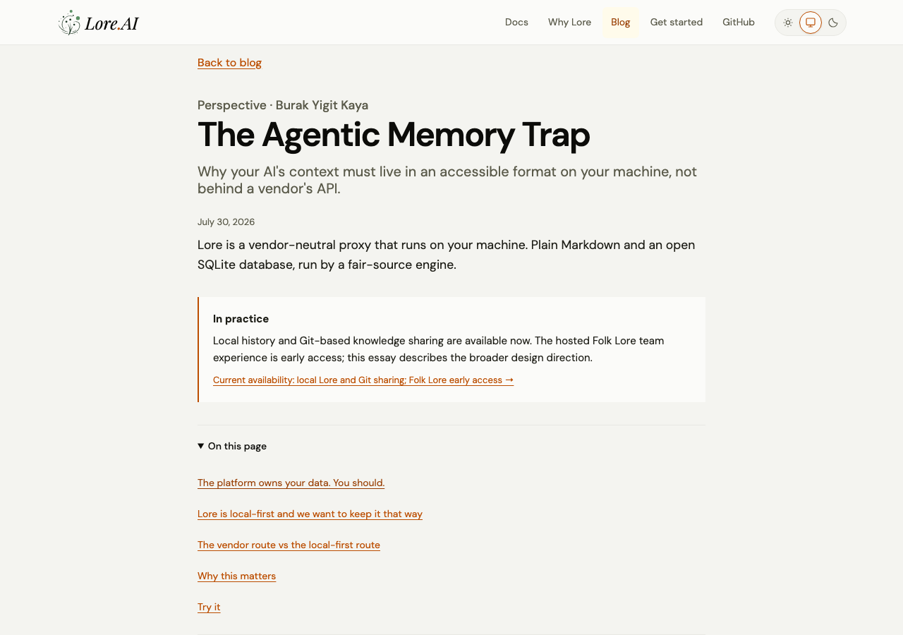
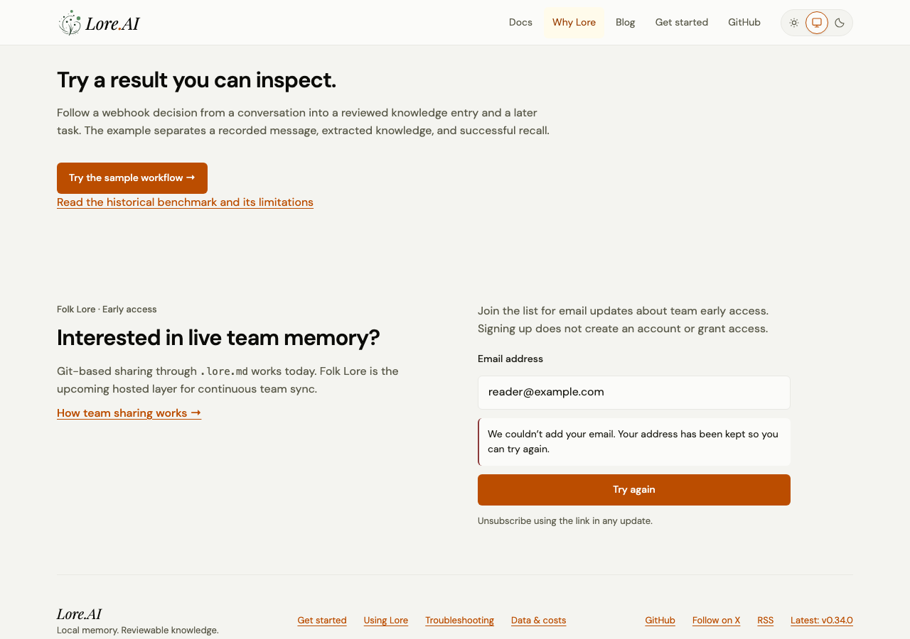

These checks establish behavior for the reviewed routes and conditions, not full
WCAG certification or a completed VoiceOver/NVDA audit. No real signup is submitted
while capturing or testing the error/retry flow.
