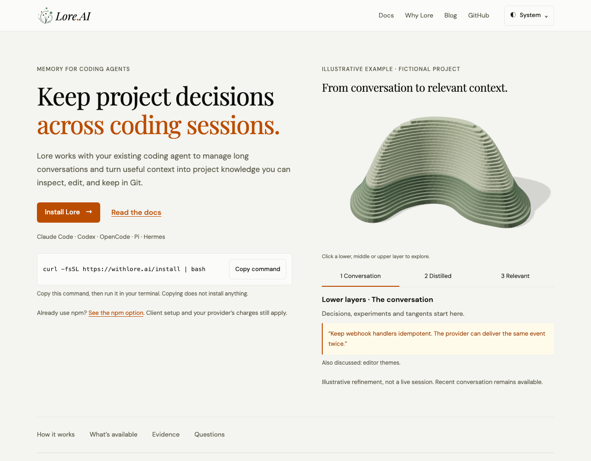
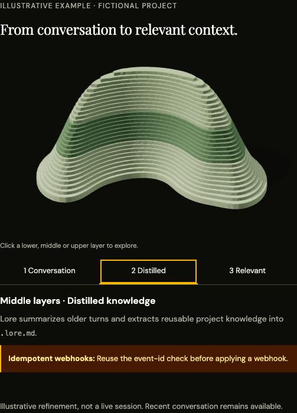

# Website UI and first-use journey

The website uses the local memory browser’s olive foundation, amber accents and
self-hosted fonts. The first-use flow now leads with concrete product copy,
installation and a clearly fictional memory example. Shared navigation and compact
native theme menus give every section a consistent structure.

The homepage presents the workflow, current Git-based sharing, one scoped historical
benchmark and practical FAQs. Folk Lore is explicitly early access. The setup guide
leads through client selection, installation, connection and verification; detailed
installer/telemetry/uninstall content and old reference fragments remain reachable.
The blog uses compact article rows and noninteractive topic metadata. The ticker and scroll reveals are removed. The homepage’s memory landscape uses elevation to explain refinement. Lower
terraces represent the conversation, middle terraces distilled knowledge, and upper
terraces context relevant to the current task. Clicking or tapping a terrace selects
its native stage control and highlights the same elevation band across the landform;
controls select the band in return. The example follows a webhook decision from a
conversation containing an editor-theme tangent to a distilled fact and relevant
context for adding retries. Other history stays searchable and recent conversation
remains available. It illustrates selection within a context budget, without
claiming perfect filtering. Peak markers, floating labels and checkpoint routes
are removed. An open crescent ridge wraps terraces around an inner valley and narrows to an upper crest.
On selection, the band highlight sweeps between elevations while transient brass
fragments climb and thin out. These are abstract details, not actual record counts.
Rapid choices retarget the visible transition; hidden/offscreen/context-loss states
settle immediately. Reduced motion uses the finished SVG state. Dragging turns the
terrain without changing the stage; there is no idle animation. The camera fits the
full drag and pointer-parallax envelope, including lower walls and bevels.

The server-rendered SVG shares the terrain contours, camera and elevation bands
with WebGL. Native controls remain usable without JavaScript; clicking the SVG
terraces also works when reduced motion, low device memory or GPU failure keeps the
static view. Hidden/offscreen states stop rendering, and disposal releases GPU
resources. Clipboard failure, release lookup failure,
signup timeout/retry and menu focus have explicit behavior and browser regressions.

See [the website package](../../packages/website/README.md) for maintenance and tests.

These are original Chromium screenshots of the built frontends. Before uses
upstream `82e1af50`; after uses this PR. Both builds use the same viewport, system colour preference,
and reduced-motion preference.
The GitHub release response is fixed to `0.34.0` for a stable badge. No DOM, CSS,
or image edits were applied to the captures. Desktop is 1280×900; mobile is
320×844.

| Surface | Before | After |
| --- | --- | --- |
| Homepage · desktop light |  |  |
| Homepage · mobile dark |  |  |
| Docs · desktop dark |  |  |
| Docs · mobile light |  |  |
| Blog · desktop light |  |  |

The additional landscape captures below use normal motion at 1280×1000 with the
same fixed release response. The terrain is settled; the dark image is a direct
component screenshot after selecting the middle band through the terrain. The
comparison table above uses reduced motion and shows the SVG fallback.

The interaction draws on [Emil Kowalski’s pointer and easing examples](https://emilkowal.ski/ui/good-vs-great-animations)
and [NN/G’s guidance on motion for comprehension](https://www.nngroup.com/articles/animation-usability/).
These informed direct stage selection, damped feedback and immediate example text.
Region picking uses the existing Three.js package’s
[raycaster](https://threejs.org/manual/en/picking.html).
