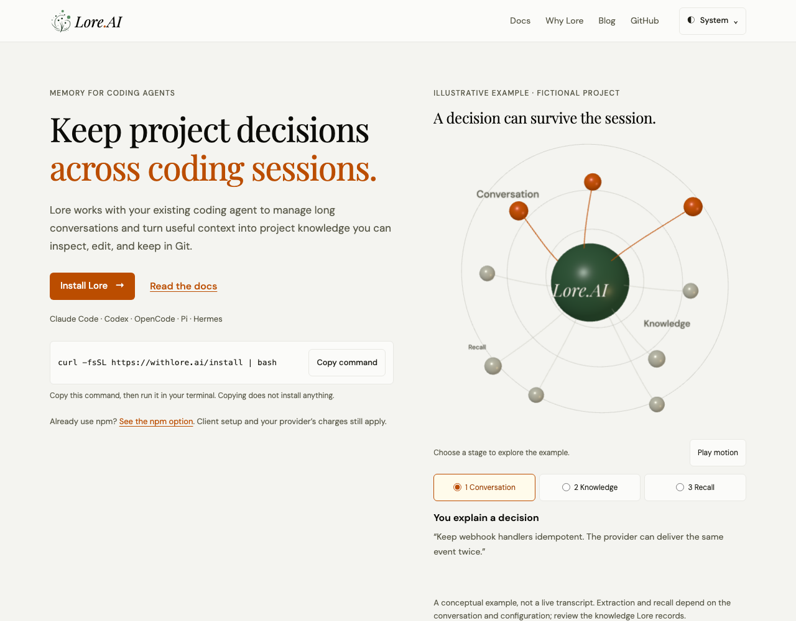
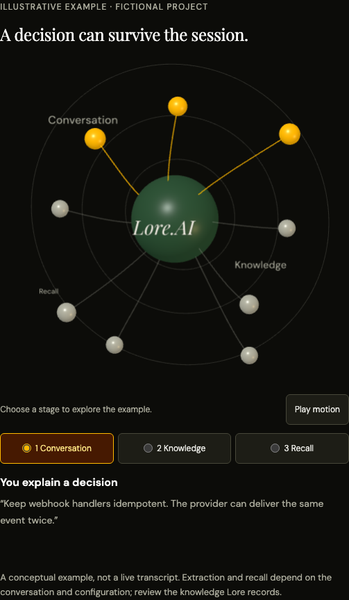

# Website UI and first-use journey

The website uses the local memory browser’s olive foundation, amber accents and
self-hosted fonts. The first-use flow now leads with concrete product copy,
installation and a clearly fictional memory example. Shared navigation and compact
native theme menus give every section a consistent structure.

The homepage presents the workflow, current Git-based sharing, one scoped historical
benchmark and practical FAQs. Folk Lore is explicitly early access. The setup guide
leads through client selection, installation, connection and verification; detailed
installer/telemetry/uninstall content and old reference fragments remain reachable.
The blog uses compact article rows and noninteractive topic metadata. The ticker and scroll reveals are removed. The round network artwork retains the
live site’s central hub, nine satellite nodes, rings and curved connections, with
lazy WebGL depth, pointer response and a pause control. Native stage choices
connect the sculpture to the fictional conversation → knowledge → recall example.
A matching SVG stays usable without JavaScript, under reduced motion or if WebGL
fails. Offscreen/hidden states stop rendering and disposal releases GPU resources. Clipboard failure, release lookup failure,
signup timeout/retry and menu focus have explicit behavior and browser regressions.

See [the website package](../../packages/website/README.md) for maintenance and tests.

These are original Chromium screenshots of the built frontends. Before uses
upstream `82e1af50`; after uses this PR. Both builds use the same viewport, system colour preference,
and reduced-motion preference.
The GitHub release response is fixed to `0.34.0` for a stable badge. No DOM, CSS,
or image edits were applied to the captures. Desktop is 1280×900; mobile is
320×844.

| Surface | Before | After |
| --- | --- | --- |
| Homepage · desktop light |  |  |
| Homepage · mobile dark |  |  |
| Docs · desktop dark |  |  |
| Docs · mobile light |  |  |
| Blog · desktop light |  |  |

The additional graph captures below use normal motion at 1280×1000 with the
same fixed release response. Motion was paused through the visible control before
capture; the dark image is a direct component screenshot. The comparison table
above continues to use reduced motion so it also shows the SVG fallback.

