# Website UI and first-use journey

The website uses the local memory browser’s olive foundation, amber accents and
self-hosted DM Sans. Serif lettering is reserved for the brand mark. The approved
quest journal replaces the 3D camp; its local Quiver illustrations, quiet margins,
numbered choices, and explicit selection marks now connect the homepage, actual-app
tour, client setup, Starlight docs, Why Lore and blog.

The homepage starts with a concrete explanation and a readable `.lore.md` artifact.
An actual-app preview comes before the journal. Conversation is the default chapter;
one durable project decision becomes reviewable knowledge, then relevant context for
a later task. An optional inventory keeps secondary choices out of the main reading
path and uses full-width phone rows. Source and file excerpts expand natively.
Task-specific reasons explain why a rule is supplied; unrelated rules remain stored.
The journal is explicitly fictional rather than a live agent or curation run.

The three native radio groups work without JavaScript. Enhancement keeps
`chapter`, `entry`, and `task` in one allowlisted history entry and restores them
on reload or Back/Forward. Other parameters and fragments survive. Valid explicit
URL state wins; early native choices survive delayed initialization otherwise.
Pointer selection on phones brings the selected card’s rule into view; keyboard
selection keeps radio focus. Short pointer transitions respect reduced motion.

The product tour continues to use original captures of the built Solid app with
fictional API fixtures. It opens no gateway or production database. Setup keeps
all six existing client choices, copy/error handling and the connection-to-first-
session path. Pagefind, generated references, public fragments, signup recovery,
compact Light/System/Dark controls, and availability/cost distinctions remain.

Nine Quiver objects (18 geometry-identical light/dark SVG variants) ship as static local geometry-only images, with no external
resources, scripts, or account metadata. Source provenance is in
[the art directory](../../packages/website/public/journal-art/README.md). The old
renderer, geometry/fallback code, and Three.js/type dependencies are removed.

## Current visual evidence

These are direct captures of the built website. Desktop captures use the normal
1280px browser width; phone captures use 320px. Both appearances are represented.
No DOM, CSS, or image edits are applied to the captures. The original pre-PR PNGs
remain available for the baseline design at `82e1af50`; the current captures below
show the journal rather than the earlier camp iterations.

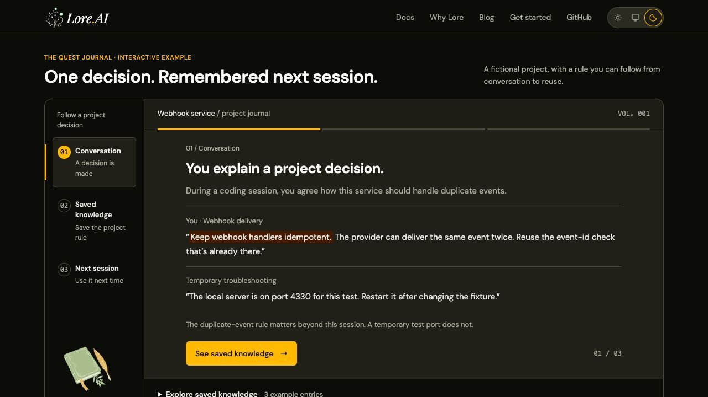
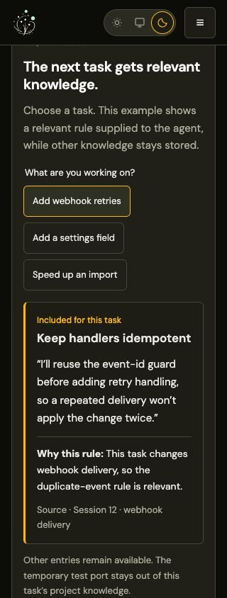
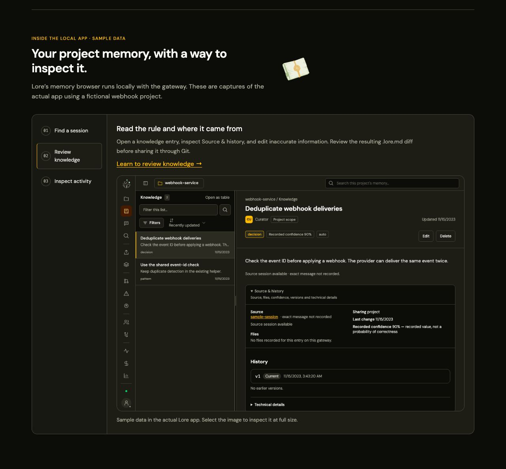
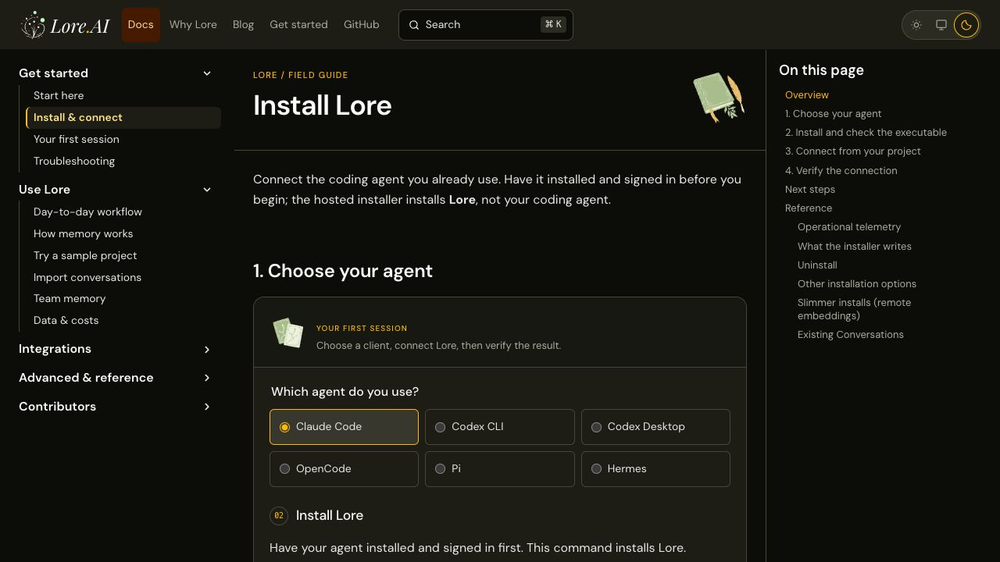
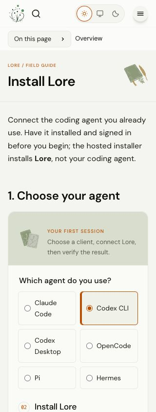
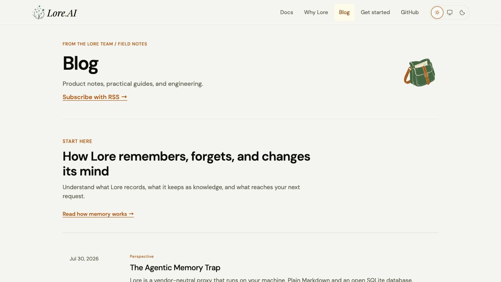
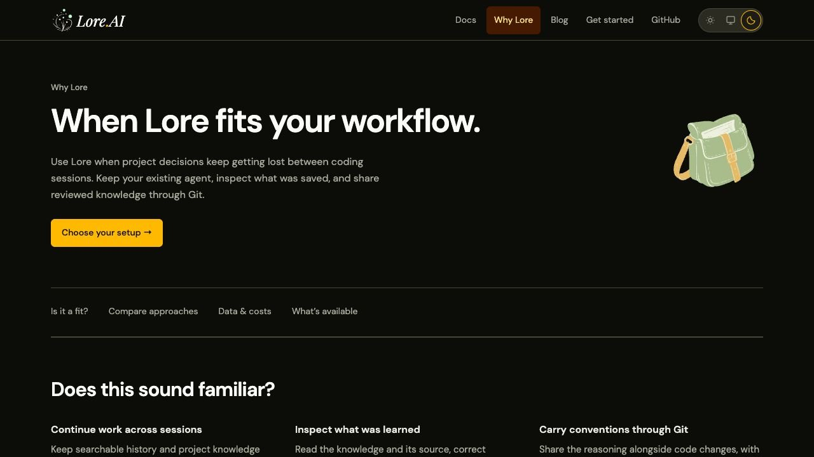
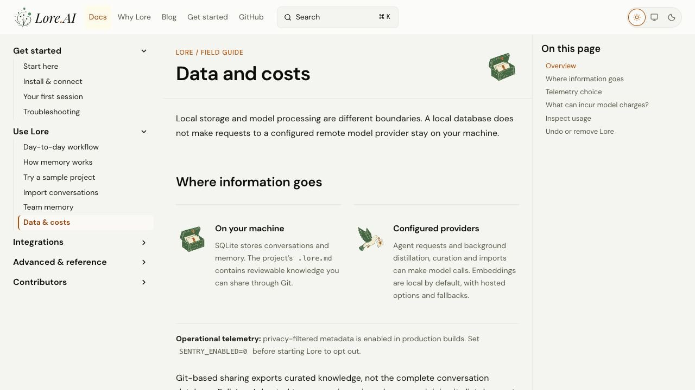
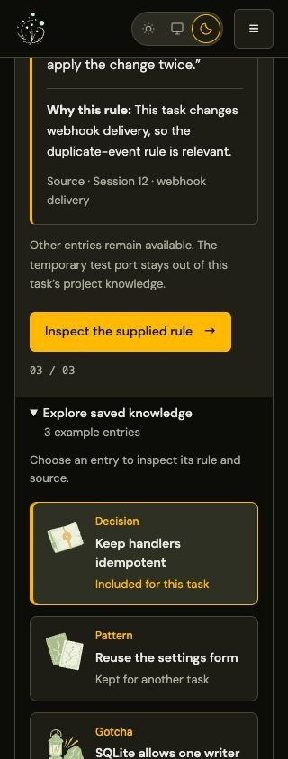
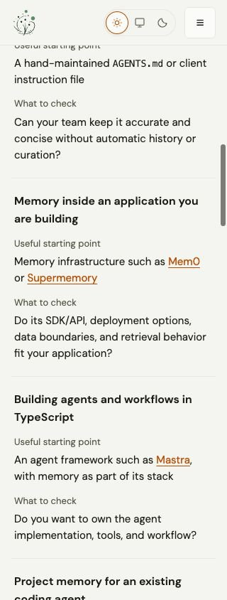

See [the website package](../../packages/website/README.md) and
[the current approved design](../superpowers/specs/2026-11-06-website-story-design.md)
for implementation and maintenance.

## Approved audit coverage

| Idea | Delivered behavior |
| --- | --- |
| 1. Actual product | One homepage Knowledge preview links to the full Sessions, Knowledge/source-history, and model-activity tour |
| 2. Agent selection | Installation and first-session guides offer six fixed choices, separate Codex CLI/Desktop paths, and Pi prerequisites |
| 3. First success | First-session guide checks a recorded message, with connection-to-verification links |
| 4. Everyday use | Task guide for resuming, finding decisions, correcting knowledge, switching agents, and sharing |
| 5. Journal relevance | Three chapters follow a useful rule; choosing a later task shows the matching knowledge and keeps unrelated entries stored |
| 6. Memory concepts | Stored history, distillations, knowledge, and supplied context have distinct explanations |
| 7. Docs structure | Get started, Use Lore, Integrations, Advanced/reference, and Contributors groups |
| 8. Search | Built Pagefind with root and prefixed-preview search-result navigation verified |
| 9. Troubleshooting | Symptom-based checks and expected observations, plus safe issue-reporting guidance |
| 10. Reference clarity | Curated task intros, friendly environment groups, cleaned source-comment artifacts, generator parity |
| 11. Concrete benefits | One concise homepage workflow links to the daily-use guide for resuming, switching agents, and sharing |
| 12. Decision guide | Why Lore distinguishes instruction files, application memory infrastructure, agent frameworks, and existing-client memory |
| 13. Data and costs | Local/provider/embedding/telemetry boundaries, opt-out, import preview, and estimated-versus-billed usage |
| 14. Availability | Local/Git features and Folk Lore early access are explicit, including historical article notes |
| 15. Concise copy | Redundant copy instructions and fictional-example disclaimers removed; setup prerequisites clarified |
| 16. Hierarchy/navigation | Short homepage overview; full tour, setup, evaluation, and team signup disclosed on destination pages; functional docs headings |
| 17. Practical blog paths | Plain article kinds, takeaways, availability context, and specific next steps |
| 18. Reproducible proof | Webhook conversation, illustrative knowledge diff, later task, and separate observable milestones |

No new backend behavior, dependencies, accounts, permissions, or guaranteed performance
claims are introduced. The command contract test caught the incorrect `claude-code`
launch token before it was corrected to the actual `claude` executable.

## Follow-up design and accessibility audit

All eight approved improvements are included:

| Area | Delivered behavior |
| --- | --- |
| Navigation | Docs identifies its section; Get started remains an action rather than a second current destination |
| Setup state | Allowlisted agent selection persists in the URL, reload, Back, and Forward; delayed initialization preserves early native choices |
| Product preview | Knowledge preview opens the matching tour state; mobile uses actual 390×700 app captures; full-size originals remain linked |
| Selected state | Compact theme pill retains its size and now uses an accent border exceeding 3:1 against its surrounding fill |
| Hero explanation | One direct explanation of running Lore locally with an existing coding agent and reviewing project rules in Git |
| Proportions | A full-width journal replaces the camp, with compact chapter/card controls and no WebGL dependency |
| Articles | Long posts gain a native collapsible outline linked to generated heading IDs |
| Signup recovery | Email and form stay visible on failure, with associated feedback and a one-action retry |

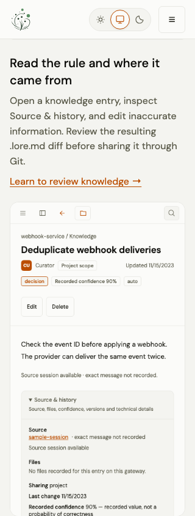
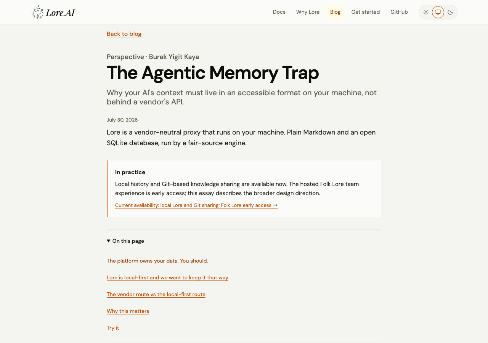
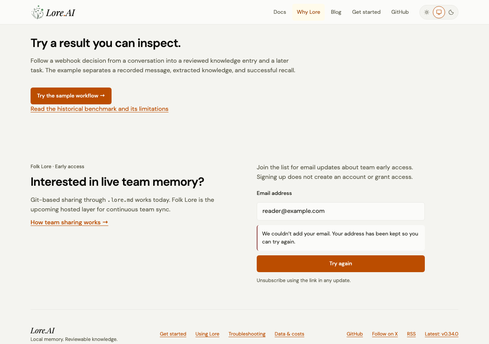

These checks establish behavior for the reviewed routes and conditions, not full
WCAG certification or a completed VoiceOver/NVDA audit. No real signup is submitted
while capturing or testing the error/retry flow.

## Product-story and visual QA follow-up

| Area | Delivered behavior |
| --- | --- |
| Product proof | Readable knowledge-file artifact near the headline; actual app before the fictional journal |
| Journal sequence | Conversation → Saved knowledge → Next session; optional inventory, real file excerpt and task-relevance reasons |
| Readability | 15px reading text, 13px controls/status, full-width phone inventory; unrelated entries retain readable contrast |
| Setup | One visible sequence, six clients, honest “See verification steps” action, recorded-session example and preserved legacy fragments |
| Source fidelity | One consistent webhook rule across the journal, actual-app record, two revisions and linked conversation; exact-message limitation stated |
| Illustration | Nine purposeful objects, separate light ink palettes, local inert geometry and no brightness filter |
| Memory model | Recent conversation, distilled context and relevant knowledge shown as current-request inputs; stored history remains searchable |
| Decision guide | Fit-first introduction, all comparison facts stacked on phones, explicit local/provider/telemetry boundaries |
| Reading paths | Practical featured article, quiet metadata, relevant availability notes and compact, purpose-specific docs artwork |

One hundred fifty repeated delayed-load cases also pass across all five projects.
The regression suite covers the new default, optional inventory, composed text
contrast, light/dark artwork, setup destination, legacy fragments, no-JS dark
verification, responsive comparisons, memory diagrams and article hierarchy.
Existing URL/history, delayed-native, keyboard, reduced-motion, theme, setup and
product-tour contracts remain covered. Test results and the broader root-suite
limitations are recorded in the PR; website checks alone do not imply a passing
core/gateway suite or completed assistive-technology certification.

Current validation: 362 browser checks pass with eight conditional skips across five
viewport/appearance configurations; the final diagram alignment regression passes
in all five. Thirteen website unit tests and Astro diagnostics pass. A prefixed
build serves all 37 HTML pages and exercises journal history, setup/tour state,
local images and Pagefind navigation at 1280px and 320px without failed assets or
runtime errors. All 817 internal fragment links and 91 local HTTP destinations pass. Separate correctness and security reviews audit parser stability,
SVG geometry/paint safety, and factual boundaries. Full repository testing remains
separate and is reported with exact local failures in the PR.

## Floating field guide navigation

The user-approved floating field guide replaces the earlier three-link bar on
public pages, blog, tour and documentation. The RPG journal and product-story
sections stay intact. All destinations are real native links beneath BASE_URL.

| Before | After | Why |
| --- | --- | --- |
| Full-width bar with a divider beside the logo | Inset rounded olive frame and modern DM Sans wordmark | Match the approved preview and app palette |
| Three ungrouped section links | Product and Resources disclosures with descriptive destinations | Explain what a page helps the reader do |
| All navigation uses text alone | Featured journal and setup artwork inside the menus | Carry the field-guide character into navigation |
| Accent-filled installation utility | Neutral ink action with a small amber arrow | Give setup a clear endpoint without crowding the bar |
| Desktop dropdown stays open after Tab leaves | Native disclosure closes when focus moves outside | Keep the next control unobscured without moving focus |
| Compact docs search stretches into an empty field | 44px icon button with the original search dialog | Keep compact navigation deliberate and usable |

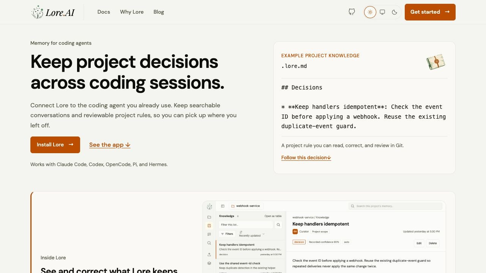
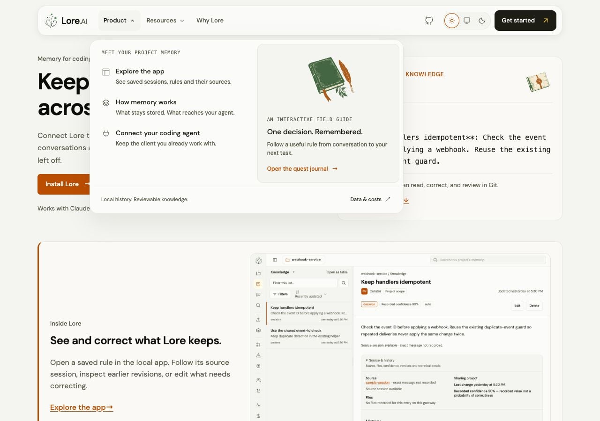
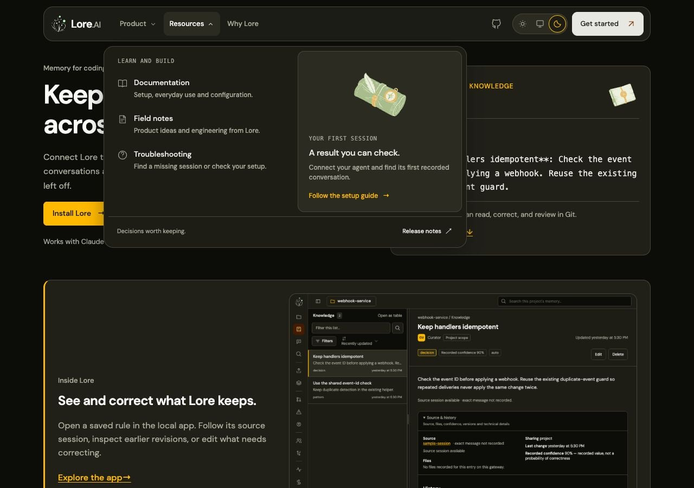
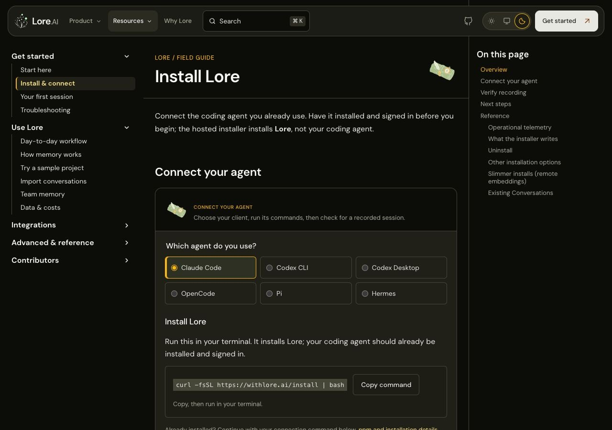
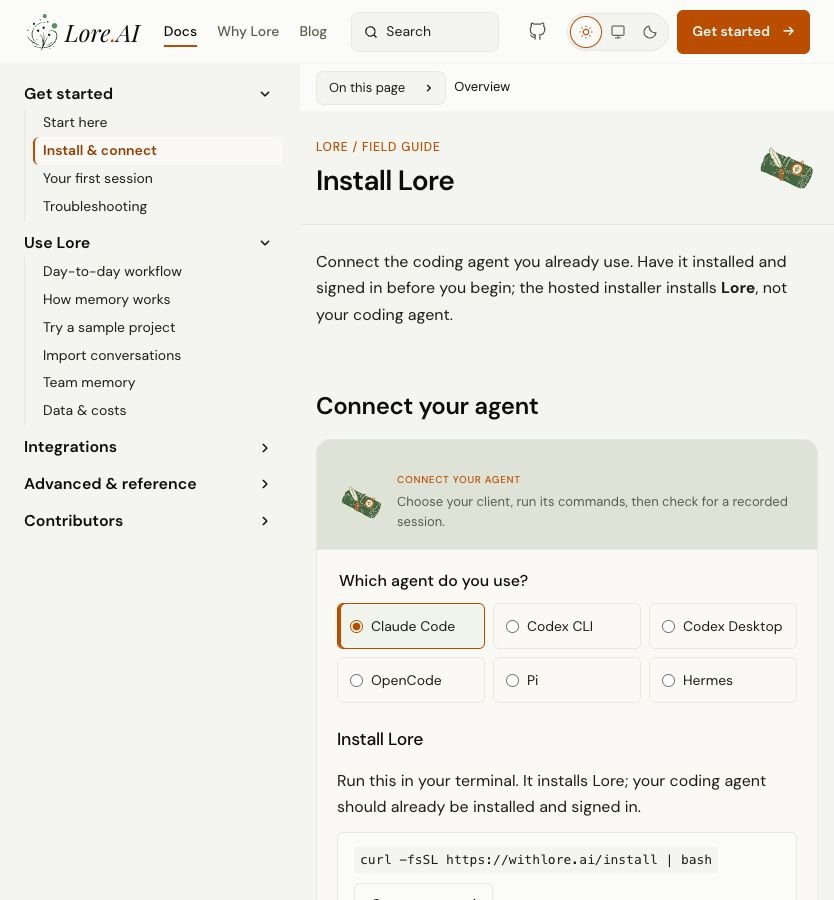
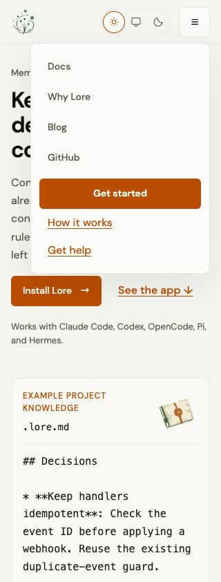
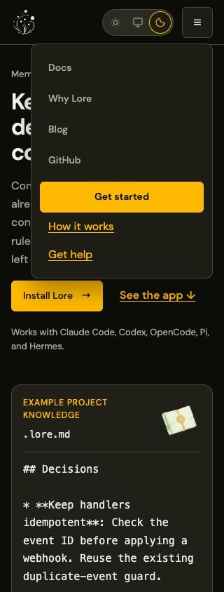

Native disclosures work without JavaScript. The enhancement handles Escape,
outside clicks, link selection and focus leaving; native named disclosures ensure
rapidly opening another group keeps the newest menu open. Current-section marking
is separate from setup actions, including when multiple Product links lead into
the docs. The theme pill retains its existing behavior and contrast ring.

The complete website suite passes 377 browser checks with eight conditional skips
across five configurations. Coverage includes phone widths on either side of the
wordmark breakpoint, coarse pointers, no-JavaScript navigation, native journal
fragments, synchronous disclosure opening, and compact docs search. Thirteen
website unit tests and Astro diagnostics for 48 files pass. A prefixed build serves
all 37 HTML pages and exercises menu destinations, artwork, journal history,
setup/tour state and Pagefind at 1280px and 320px. All 989 internal fragment links
resolve. Independent correctness/security reviews and broad repository checks are
reported separately in the PR; the website results do not imply a clean local
full-repository suite.

## Field-guide pages

All ten approved page improvements are implemented. These captures supersede the
older homepage, tour, docs directory and blog compositions shown above.

| Before | After | Why |
| --- | --- | --- |
| Hero opens with raw Markdown | Readable rule / Markdown selector with an example source | Explain the saved knowledge before its syntax |
| Tour mainly switches screenshots | Rule/source/history inspection points with readable notes | Explain the actual app while preserving original captures |
| Journal repeats its explanation | Shorter chapter copy and carried-rule highlights | Make the decision-to-reuse connection easier to follow |
| Everyday section repeats the overview | Three concise task links | Give each homepage section a distinct purpose |
| Large agent tiles and separate success explanation | Compact client pills, numbered sequence and reader observation | Keep commands and verification clear without simulated detection |
| Docs starts as a list of prose links | Illustrated task directory | Lead readers to the result they need |
| Comparison is only a table | Workflow selector with highlighted row and complete table | Explain fit without hiding alternatives |
| Blog illustration floats beside the masthead | Illustrated featured article and contextual diagrams | Give the artwork a role in the story |
| Troubleshooting begins with reference text | Symptom → check → expected result guide | Help readers choose their next observable check |
| Shared controls inherit prose spacing | Consistent surfaces, selected borders and scoped control spacing | Carry the header's deliberate design across pages |

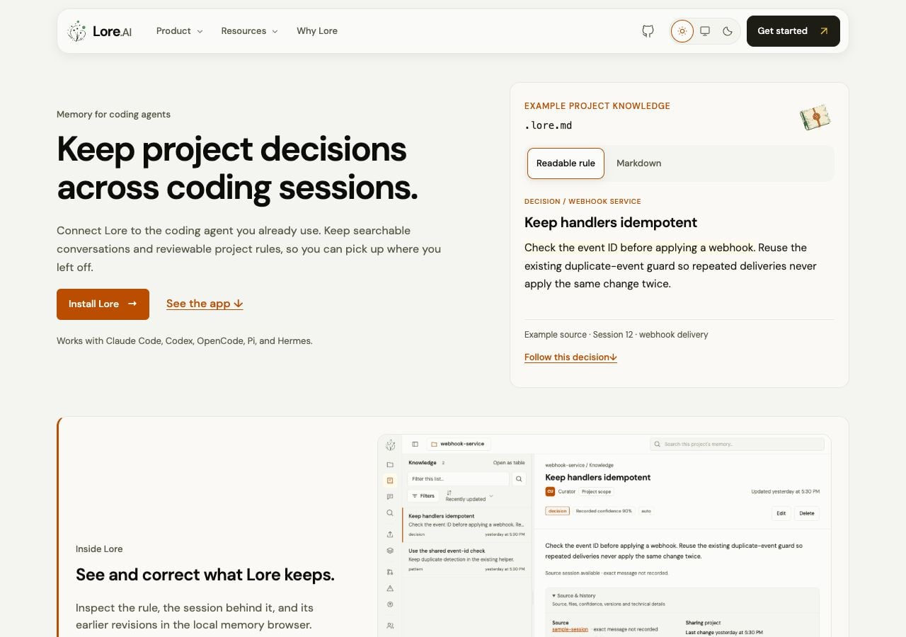
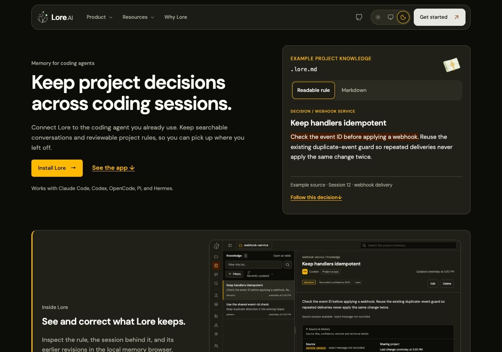
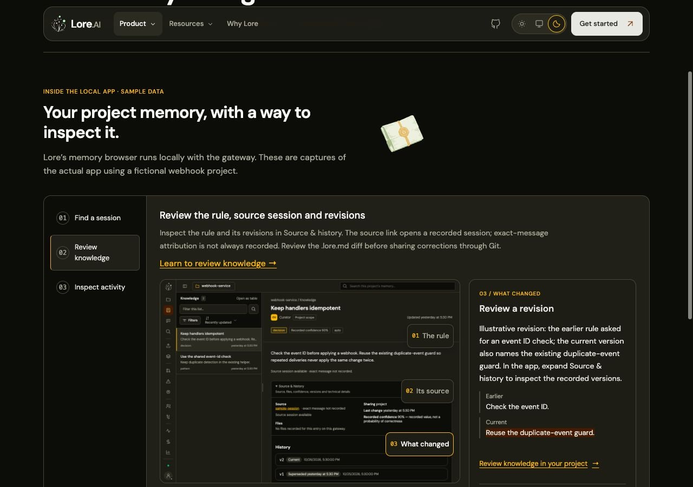
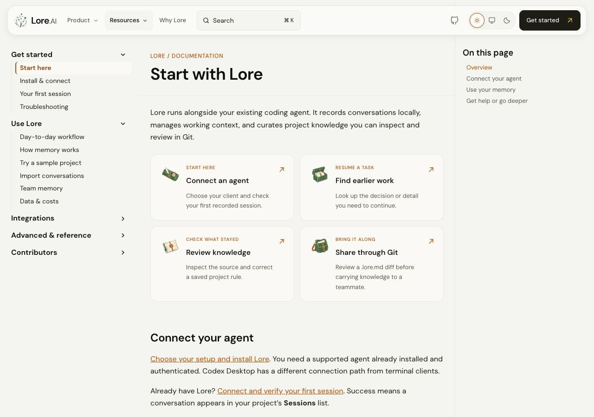
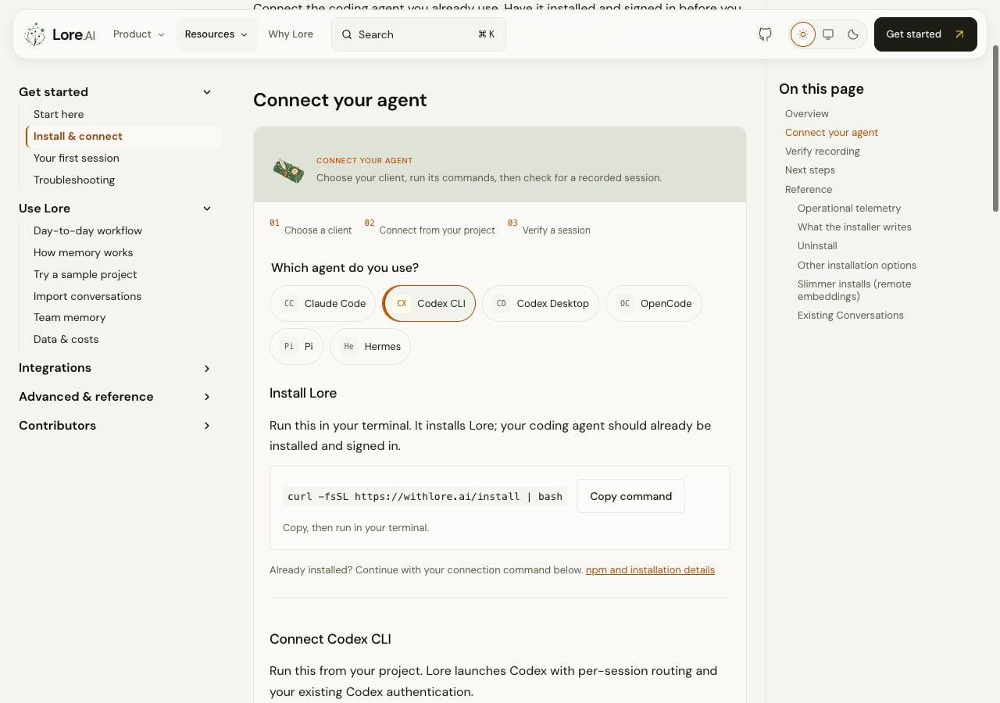
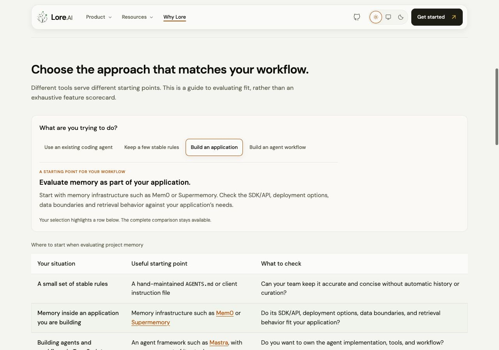
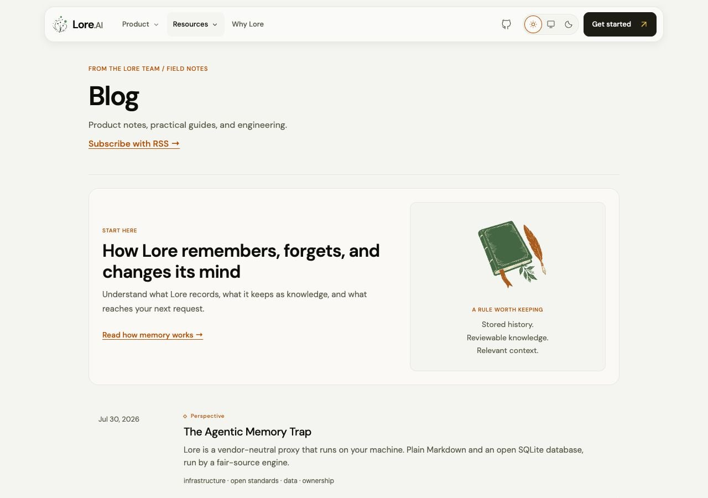
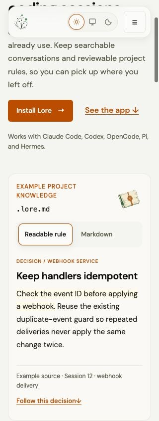
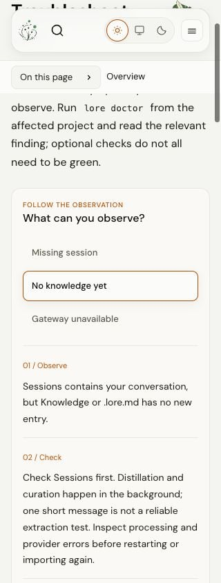
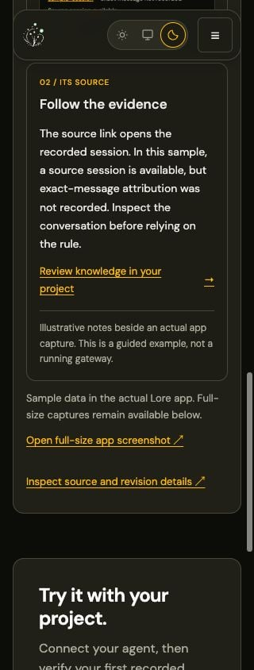
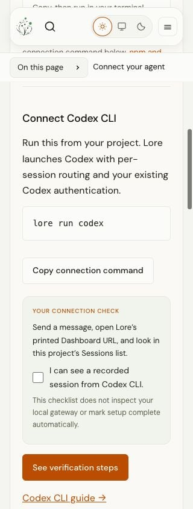

The final website browser run passes **447 checks with eight conditional skips**
across five configurations. New regressions cover independently restored choices,
malformed queries, delayed enhancement, native fallbacks, per-client confirmations,
article-specific destinations, 44px targets, compact label margins, selection-border
contrast, and markers remaining within the actual image at 1001–1280px. The marker
and contrast regressions were observed failing before their fixes. Phone coverage
also exercises 320px, 390px, 768px and 1024px widths. Thirteen units, Astro diagnostics for 54 files,
workspace typecheck/lint/format, generated-doc parity and 37-page social metadata checks
pass. All 1,003 internal fragment links resolve. The prefixed build verifies the four
new query groups alongside journal history, setup/tour state, artwork and Pagefind
at 1280px on desktop and 320px on phone.

Independent correctness and security source reviews found no remaining blocker for
the draft update and exercised the real URL helper with seeded adversarial inputs.
These are source/UI results; no fresh full-repository pass is claimed. Broad local
core/gateway test failures remain a separate before-merge gate, and hosted CI is
reported for the pushed head. The RPG journal, floating header, canonical setup
commands, existing fragments and complete comparison stay available. No backend,
new dependency or automatic connection detection is introduced.

## Product spotlight refinement

The homepage product proof is a compact workbench with the heading above it,
replacing the large split text/screenshot panel shown in earlier captures. Rule,
Source and History select focused crops of the actual app detail and concise notes.
The image and notes link into the matching full tour; the original capture remains
available. History uses the actual v2/current and v1/superseded labels, and Source
retains the exact-message qualification.

| Before | After | Why |
| --- | --- | --- |
| Vertically centered copy in a large empty column | Short heading and tour action above the preview | Give the app detail the space |
| Whole interface shrunk into one screenshot | Close-ups of the selected record area | Keep the proof easier to read |
| Static image with a separate caption/link | Native Rule / Source / History controls and matching tour links | Let visitors inspect the part that interests them |
| Extra accent stripe and nested frame | One inset workbench with a quiet divider | Reduce competing containers |

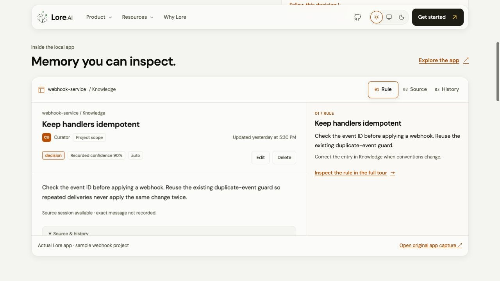
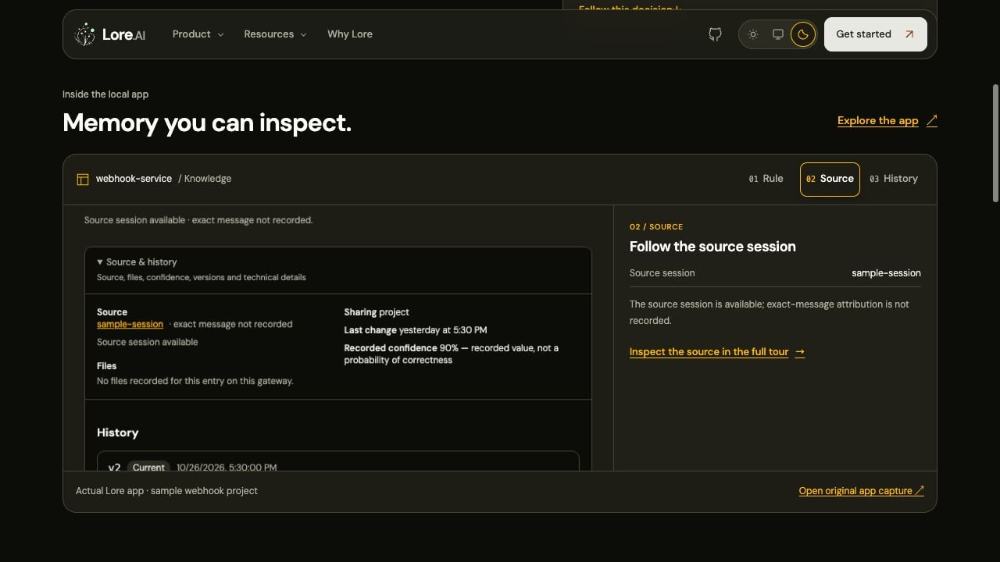
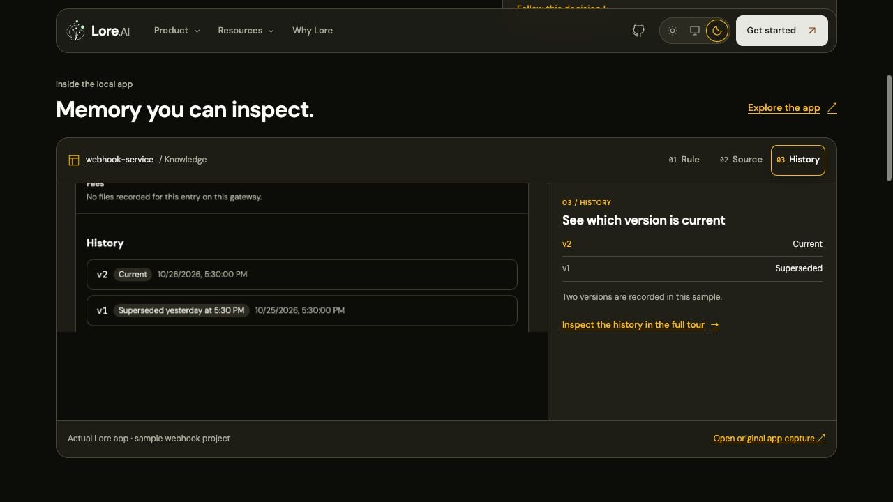
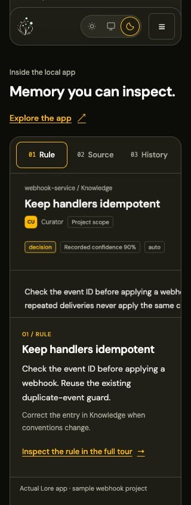

The final website suite passes 472 browser checks with eight conditional skips. New
regressions cover compact dimensions, independent preview/history state, matching
tour destinations, malformed values, early native choices, keyboard focus and
no-JavaScript dark captures. The image link draws its focus ring inward to keep it
visible inside the clipped frame. Explicit themes retain precedence over the
system appearance. Thirteen unit tests, Astro checks for 55 files, workspace
typecheck/lint/format and social metadata checks pass. The prefixed build checks
this preview together with the existing page interactions; all 1,007 internal
fragment links resolve. Separate correctness/security source reviews found no
remaining spotlight blocker; full-repository validation remains separate before
merge. Original PNGs are unchanged, and the journal and other page flows remain.

## Shared accordion refinement

Content disclosures now use one native Astro adaptation of the
[shadcn/ui accordion pattern](https://ui.shadcn.com/docs/components/accordion), with
[upstream attribution and MIT license](../../packages/website/src/components/ui/SHADCN-LICENSE.md).
The composition supplies a full-row trigger, trailing stroke chevron, subtle hover,
visible keyboard focus and consistent answer spacing while retaining the field
journal palette. It adds no React/Radix dependency.

| Before | After | Why |
| --- | --- | --- |
| Browser triangles before each question | Right-aligned chevrons and full-row triggers | Make the available action clear without interrupting the question |
| Large padding and an opening accent stripe that shifts content | Compact separators with a stable text column | Keep the FAQ calm and easy to scan |
| Separate native presentations in journal and articles | Shared source, Markdown, inventory and article outline disclosures | Make repeated interactions predictable |
| Small docs tree group targets | 44px minimum targets with visible focus | Make navigation easier to operate by touch and keyboard |

FAQ answers are single-open and collapsible. Journal source and Markdown can stay
open together; inventory and header menus do not share the FAQ group. Starlight
retains its navigation controllers and stored sidebar state. All content disclosures
work natively without JavaScript, and early opening survives deferred enhancement.
Keyboard changes are immediate; pointer-only motion honors reduced motion and uses
progressive CSS intrinsic-size interpolation where supported.

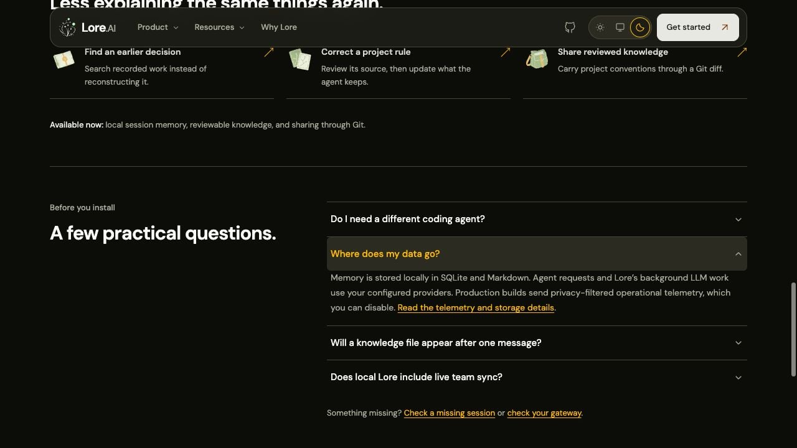
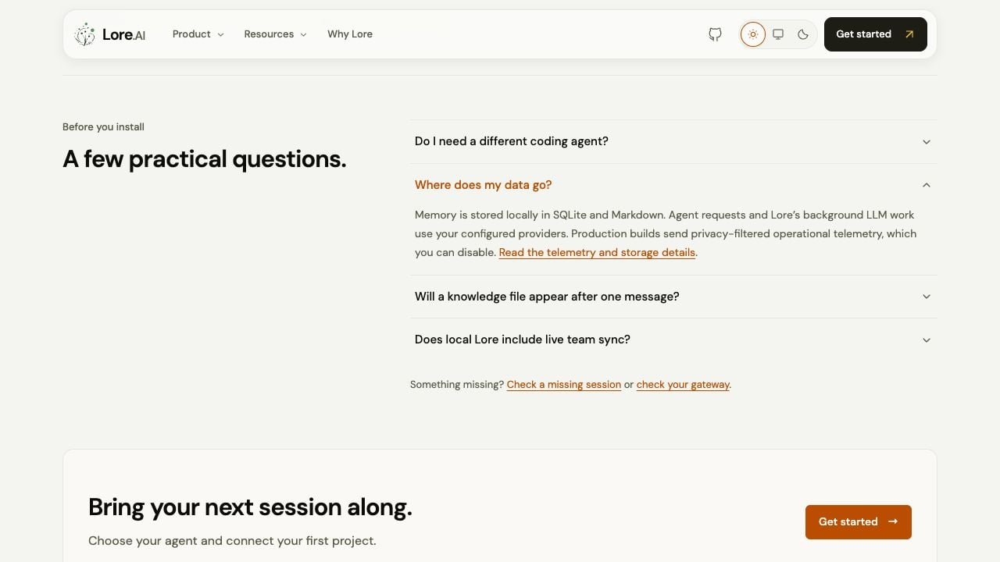
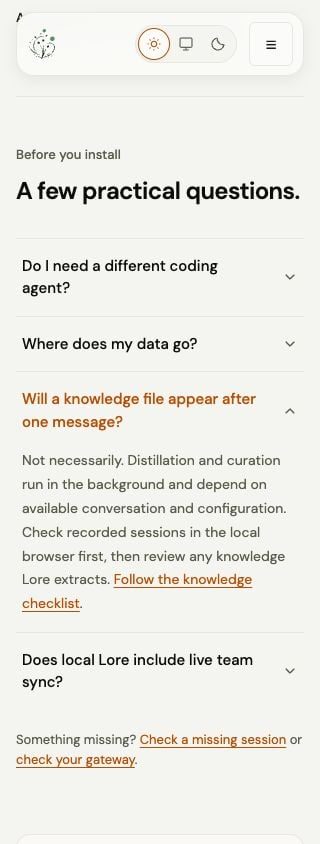
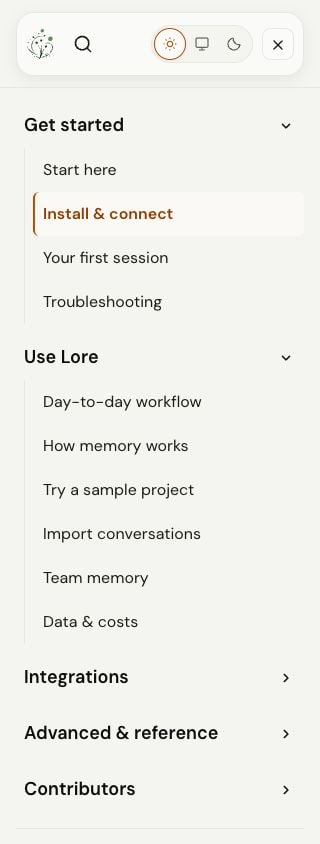
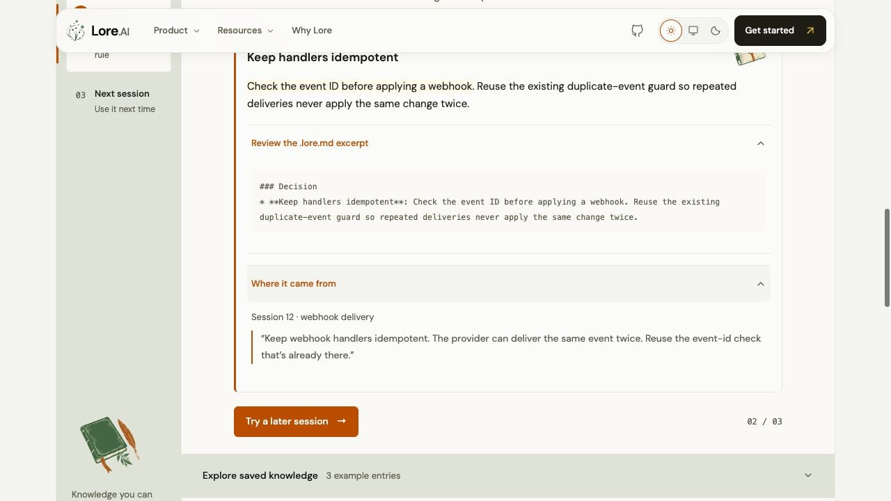

Validation for this refinement covers keyboard Enter/Space and focus, native FAQ
exclusivity, independent journal panels, early native input, no-JavaScript phone
controls, long question/chevron wrapping, reduced motion and docs navigation/TOC.
The adversarial review also reproduced and fixed mixed-input group closing: a
keyboard-opened sibling must clear motion on the pointer-open answer it closes.
The wider full-repository gate remains separate before merge; this draft update
does not assert that the previously failing core/gateway suite is resolved.

Final website verification: **507 browser passes / eight conditional skips** across
five viewport/theme projects (including 35 accordion cases), 13 unit tests, clean
Astro diagnostics for 58 files, workspace typecheck/lint/format, generated-doc parity
and complete social metadata on 37 pages. The prefixed build exercises accordion
exclusivity and docs links alongside the existing journal/setup/tour/search flows at
1280px and 320px with no failed assets or runtime errors. All 1,007 internal fragment
links resolve.

Separate adversarial correctness and security source reviews pass after the mixed-input
fix. Independent static checks and 10 seeded controller-property runs pass; both reviews
retain the wider repository before-merge gate rather than claiming merge approval.
