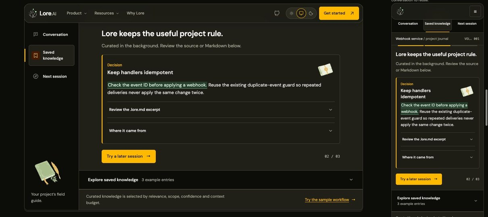

# Website QA — 14 November 2026

Reviewed the rendered layouts of all 36 content routes at 1280px in light mode
and 390px in dark mode. Checked the journal, product tour, mobile menus, setup,
reference lookup, comparison, blog and 404 search journeys. Automated coverage
also exercises 320px phones, both themes, keyboard controls, no-JavaScript
fallbacks, reduced motion and browser history.

## Resolved findings

| Finding | Result |
| --- | --- |
| Journal chapter headings could remain behind the floating navigation on short screens. | Advancing focuses the heading and scrolls only far enough to expose it, respecting the page's navigation clearance. Radio navigation and history retain their existing focus behavior. |
| Enlarged text pushed Appearance controls outside the narrow docs menu. | The row wraps, and keyboard scroll clearance scales with text size. |
| The docs menu had a 32px target and moved outside its fixed bar at 200% root text size. | A 44px target sits inside the physical header, with consistently sized search/menu icons and matching content offsets. |
| Retained knowledge was green in the hero but amber/red in the journal and tour. | Shared light/dark green tokens now cover those examples; text contrast is 8.16:1 in light and 9.72:1 in dark. |
| Pages with no diagrams loaded the Mermaid engine. | Only pages with Mermaid source blocks import the local renderer. All five architecture diagrams still render. |

Measured decoded JavaScript resource bytes in fresh production-preview browser
contexts (uncompressed resource size, not compressed wire transfer):

| Page | Before | After |
| --- | ---: | ---: |
| Home | 632,720 | 12,183 |
| Blog index | 626,851 | 6,305 |
| Install | 636,464 | 15,918 |

## Evidence and validation

This composite contains resized, otherwise unedited screenshots of the built
website at 1280px and 390px. The floating navigation and RPG journal remain.

The regression file `packages/website/test/browser/qa-regressions.spec.ts`
reproduced the original overflow, hidden focus, undersized target, mismatched
highlight and eager-script-load failures before the corresponding fixes.
The enlarged-text cases explicitly set the document root font size to 200%.
Separate correctness/security reviews cover the changed runtime sources.

Final website suite: **847 passed, 8 conditional skips, no failures** across
desktop light/dark, 320px mobile light/dark and compact desktop. Website units:
**19 passed**. Workspace typecheck, lint and formatting pass; generated reference
parity, 37-page prefixed links and social metadata checks pass. The root build
resolves 1,137 fragment targets and 14 themed picture sources without errors.
Hosted CI is verified separately on the committed PR head. The earlier local
full-root interruption is not presented as a passing root suite.
