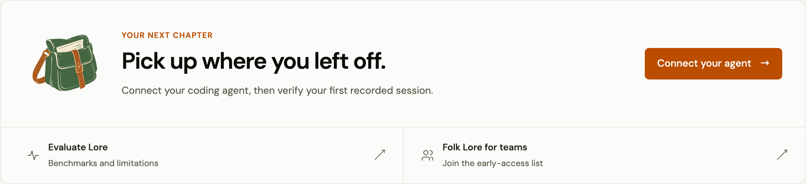
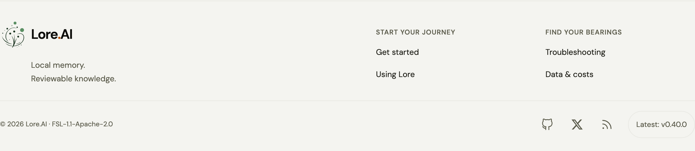
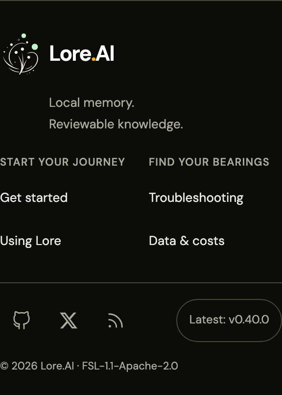
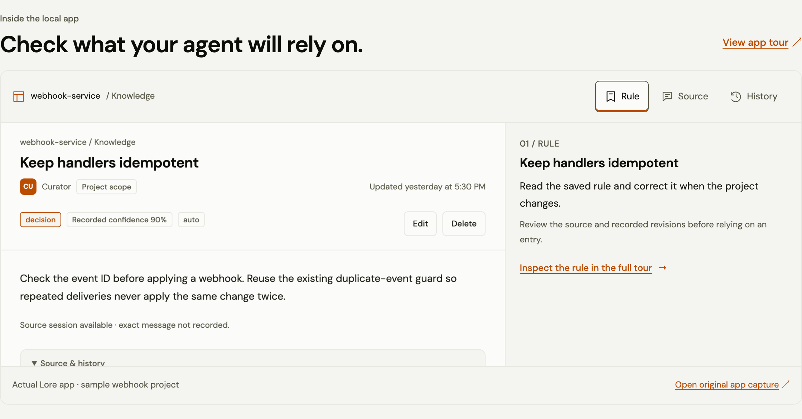

# Setup card, footer and Retina app captures

The shared setup card on home and tour uses a knowledge satchel, a direct setup
link and concise next-session copy. Homepage evaluation and team-interest links
have their own divided resource row. Existing fragment destinations are retained.

The public footer groups setup and help links, restores the full brand identity
in the footer on phones, and keeps the header's compact phone logo unchanged.
Social links retain accessible names and icon-only controls. The release lookup
still updates the existing native link; it is styled as a quiet pill.

All 24 app images now contain a native 2× browser rendering, rather than enlarged
1× pixels. The mobile crop rectangles are extracted at the same density. Mobile
and unconditional desktop picture sources declare `2x`; the legacy PNG fallback
URLs, logical dimensions and full-size links remain valid. No app UI or screenshot
pixels are redrawn. The capture script uses the built Solid app, fictional API
fixtures and a loopback server with all external browser requests blocked.

Four Retina regression checks were observed failing before the capture change.
Independent inspection verifies all 24 PNGs have twice the previous width and
height and all 12 crops exactly match decoded source pixels. Browser checks cover
actual pixel coverage at device scale 2 on home, tour and first-session proof.
The full website suite passes 987 checks with eight conditional skips across five
viewport/theme configurations. Website units pass (21); Astro checks 78 files
without diagnostics. Lint, formatting, prefixed preview links and social metadata
pass. Both source reviews found no remaining blocker; full runtime/core tests
are outside this static website follow-up.

These are direct browser captures. Only the release-lookup response is fixed for
visual consistency; the shown app data is fictional.

