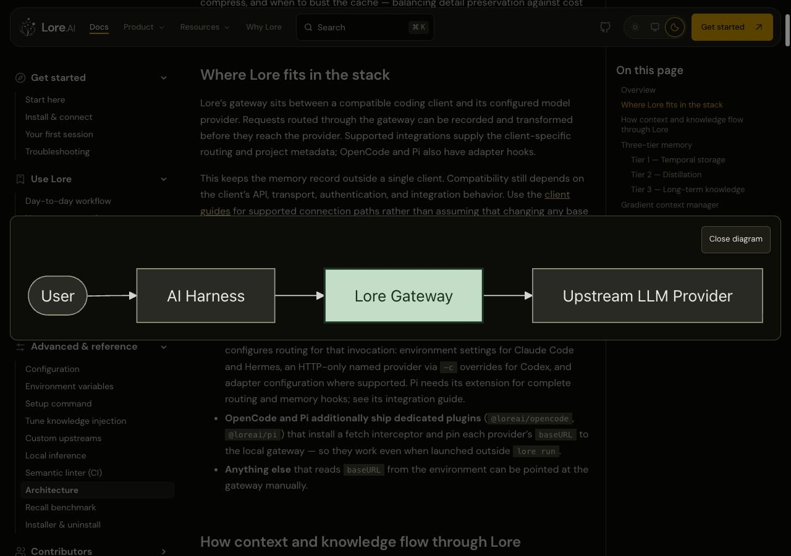
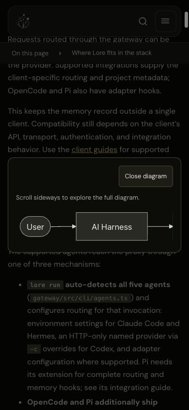
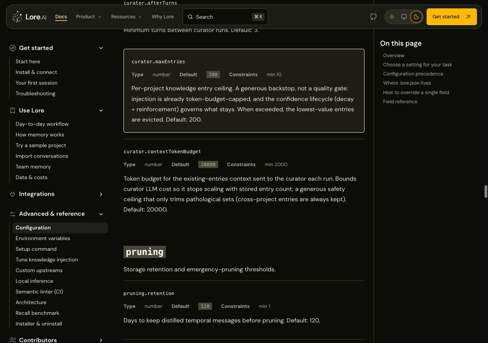

# Website clarity and usability follow-up — 16 November 2026

This implements the approved expert UI/UX audit in PR #2115. It preserves the
floating field guide, RPG journal and local app palette. This is a heuristic
review and browser verification, not a recruited usability study or a new
measured usability score.

## What changed

- The homepage leads from a concise conversation example into the interactive
  journal, then actual app proof. Less repeated copy and empty space make each
  module serve a different purpose. Retained knowledge still uses green.
- Docs is directly available in desktop navigation; screenshot destinations say
  “View app tour.” Mobile theme controls remain inside the menu.
- Installation explicitly separates macOS/Linux Bash from Windows/npm and states
  prerequisites. Codex Desktop has four ordered steps: configure, start, fully
  quit/reopen, verify. Copying a command never confirms a recorded session.
- Configuration and environment records keep names, defaults and full explanations
  together, with exact links to all 86 configuration and 52 environment fields.
  Search highlights the actual record. Authored category anchors remain intact;
  field records do not inflate the document contents menu. Generated Markdown is
  unchanged.
- Each workflow recommendation has an explicit next action. Selecting an option
  only changes the recommendation, with native keyboard/no-JavaScript behavior.
- The sample workflow documents an executable two-session engine check: recording,
  a manually reviewed correction with revision history, then retrieval of the
  corrected rule and original conversation. It deliberately excludes LLM
  extraction, client connection, task success and savings claims.
- Lifecycle copy distinguishes ordinary revisions/deletion markers from bulk
  removal, purge, Git copies and previously sent provider data.
- Architecture/blog diagrams open in a centered native modal with a backdrop,
  close action, Escape and return focus. Phone readers get a scrollable full-size
  canvas and an explicit hint. Dark neutral colors and inherited label colors
  preserve contrast; green semantic classes retain their meaning. The engine is
  still downloaded only on diagram pages.

## Verification

- Full production-browser suite: **912 passed, 8 conditional skips**, across
  desktop light/dark, 320px mobile light/dark and 1024px compact viewports.
- Website units: **22 passed**. Astro: **76 files, zero diagnostics**.
- Isolated two-session memory-engine evidence: **1 passed**. Workspace typecheck,
  lint and formatting passed (lint retains existing unbound-method warnings).
- Generated configuration/environment parity passed. Website link crawl found
  zero broken links. PR-prefixed links and social metadata passed on all 37 pages.
- Independent correctness and security reviews found no outstanding source
  blocker. Correctness review reproduced and closed the four object-field/category
  collisions; serializer/URL/clipboard and controlled Mermaid lifecycle probes
  exercised the final contracts.

Meaningful regressions were observed failing before fixes: exact field targets,
category/field collisions, independent platform state, and centered/legible diagram
modals. The new modal screenshot and mobile/reference captures below are direct
browser images compressed to JPEG, without content or style edits.

The wider local root suite was not rerun for this follow-up. The new engine test,
website gates and exact-head hosted root CI remain separate evidence. Current
hosted status is available on PR #2115; no merge or production deployment is part
of this change. Real client installation, live provider billing and assistive
technology testing remain outside these automated results.

