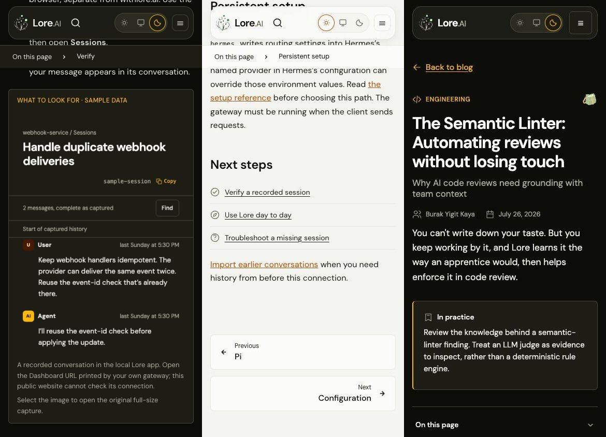
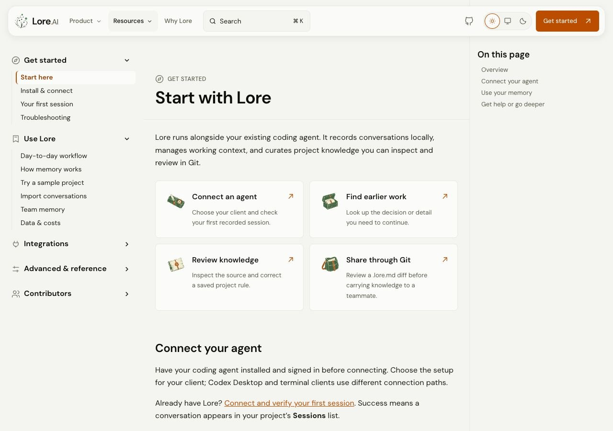
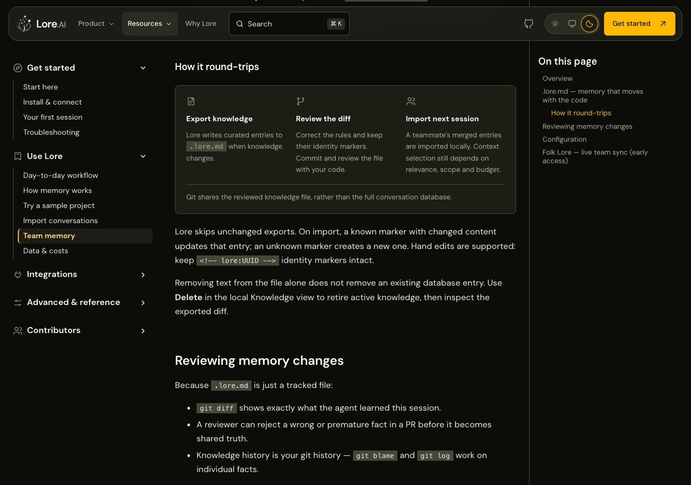

# Sitewide visual QA — 13 November 2026

This pass covers all **36 content routes**: the home, Why Lore, tour and blog
index; all six articles; and all 26 documentation pages. The production 404 was
also inspected and exercised by the browser suite. The floating navigation,
RPG journal illustrations, app palette and existing controllers are preserved.

## Findings and changes

| Surface | Finding | Delivered change |
| --- | --- | --- |
| All documentation | Chapter names diverged from the sidebar; help and adjacent-page links competed with content | Chapter icons/names match the five sidebar groups, integrations show client marks, help uses icon-and-label links, pagination is compact |
| Docs start | Repeated task kickers and prose links obscured the actual choices | Quieter illustrated task cards and grouped native action links; existing heading anchors remain |
| All five integration guides | Uneven next-step lists and repeated help links | Shared Verify / Use / Troubleshoot actions with the correct agent query; original command/configuration examples and headings preserved |
| First session | The desktop capture was unreadable at phone width | Reproducible 394×500 source crop for each theme, with a native link to the original capture and explicit sample/manual-verification qualification |
| Team memory | Dense prose made export/review/import difficult to follow | Three illustrated-by-icon stages; retained identity-marker, import/update and database-deletion caveats |
| Memory and reference | Important concepts and lookup controls depended on text alone | Consistent decorative icons for memory inputs/definitions and setting lookup; reference prose and native categories remain available |
| Why Lore | Benefits, availability and local section navigation lacked the same cues as the app | Icons identify workflow, inspection, Git sharing and availability without replacing their labels |
| Blog index and every article | Categories shared an arbitrary marker; metadata mixed category, author and framing text | Category-specific icons, separate author/date metadata, clear back/RSS actions and a quieter practical takeaway; removed unlinked tag strings |

## Coverage and results

- Reviewed first viewports on every content route at 390px dark and 1280px light,
  plus deeper views of setup/verification, guide next steps, references, memory,
  sharing, comparison, articles and recovery. Final evidence below is captured
  from the production preview; intermediate all-route captures remain temporary.
- **762 browser passes / 8 conditional skips**, across desktop light/dark,
  320px phone light/dark and 1024px compact projects. New checks cover all 36
  content routes, page-level reflow, unique headings and docs/sidebar consistency.
- The phone-proof regression failed against the original desktop source, then
  passed with the responsive capture and original-image link.
- **19 website units**, **74 Astro files with zero diagnostics**, configured
  workspace typecheck/lint/format, generated-reference parity and 37-page preview
  prefix checks passed. Static audit resolved **1,137 fragment targets** and
  **14 picture sources** with zero missing targets.
- Both new crops match their original pixels. Independent correctness/security
  reviews confirmed all six MD→MDX conversions preserve their frontmatter,
  headings and fenced command/configuration blocks. Controllers and dependencies
  are unchanged. All five architecture diagrams rendered in the production preview.
- The local development server was refreshed after MD→MDX conversion and build
  cache invalidation. This is separate from the production-build checks.

This is a visual/reflow and interaction review, not a screen-reader certification
or exhaustive review of every paragraph. The previous interrupted full-root test
attempt remains a separate limitation; website results do not imply hosted CI,
merge approval or production deployment.

Guidelines applied: [Web Interface Guidelines](https://github.com/vercel-labs/web-interface-guidelines/blob/main/command.md),
the design critique and accessibility review skills.

## Evidence

